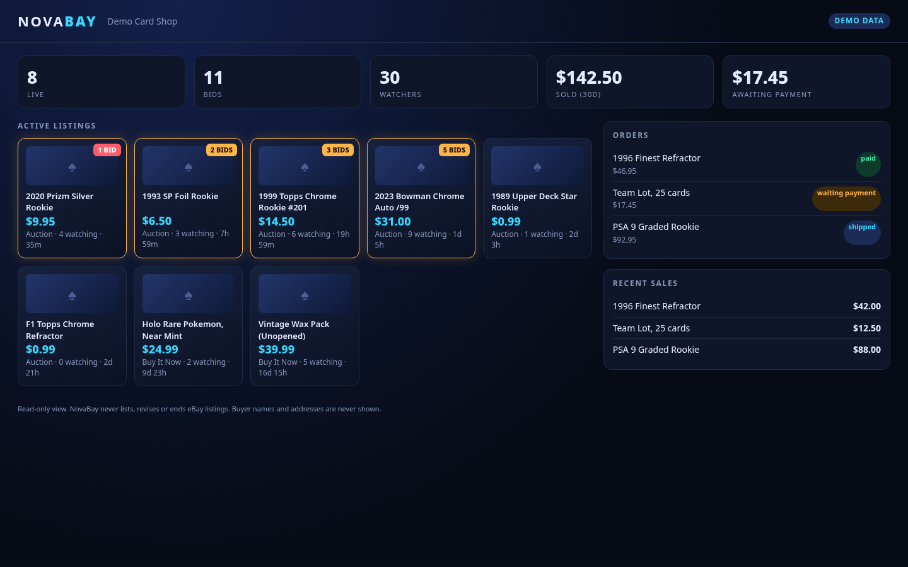

# NovaBay

A **read-only eBay seller dashboard** for Grok Bot and Cursor. Ask your agent "what has bids right now?", "what do I need to ship?" or "build me my NovaBay dashboard", and it answers from your own eBay seller account.

- **MCP server `novabay-ebay`** (Python 3 standard library only, stdio, no installs)
  - `list_active_listings`: price, bids, watchers, end time, time left, URL
  - `get_recent_sales`: sold items and totals (up to 60 days)
  - `get_orders`: payment and shipping status, with **no buyer personal data**
  - `get_seller_summary`: one-shot counts and totals
- **Skill `build-novabay-dashboard`**: builds a local one-file dashboard for your store.
- **Dashboard template** in `dashboard/` with sample data.

NovaBay **never lists, revises, relists or ends listings** and never messages buyers. It only calls eBay read endpoints (Trading API `GetMyeBaySelling`, Sell Fulfillment `getOrders`).

## Try it with no eBay account (demo mode)
Set the plugin variable `NOVABAY_DEMO` to `1` (leave the eBay keys blank). Every tool returns built-in sample listings, sales and orders marked `"mode": "demo"`.

## Setup with your own eBay account
1. Create a free developer account at https://developer.ebay.com (approval can take about a business day).
2. In **Application Keys**, create a **Production** keyset. Copy the **App ID (Client ID)** and **Cert ID (Client Secret)**.
3. Go to **User Tokens** for that keyset, choose **OAuth**, and **Get a Token from eBay via Your Application**. Sign in with your *seller* account and agree. Make sure the scopes include `https://api.ebay.com/oauth/api_scope` and `https://api.ebay.com/oauth/api_scope/sell.fulfillment.readonly`. Copy the **refresh token** (valid about 18 months).
4. In Grok Bot or Cursor, open the plugin's **Configure** screen and set `EBAY_CLIENT_ID`, `EBAY_CLIENT_SECRET`, `EBAY_REFRESH_TOKEN`, and `NOVABAY_DEMO` = `0`.
5. Ask: "Give me my NovaBay seller summary."

Optional tuning env vars: `NOVABAY_CACHE_SECONDS` (default 120) and `NOVABAY_MIN_INTERVAL` (seconds between eBay calls, default 1.0). A summary uses about 2 eBay calls; with caching, normal use stays far below eBay's daily limits.

## Privacy
- Your keys are stored only in your plugin configuration. They are never written to disk by NovaBay, never logged and never returned by a tool.
- The server talks only to `api.ebay.com`. No analytics, no third-party servers.
- Buyer names, usernames, addresses, emails and phone numbers are dropped before results reach the agent.
- Tool results are cached in memory only, for 120 s.

## Testing instructions (for reviewers)
No eBay account needed.
1. Install the plugin and set `NOVABAY_DEMO=1`.
2. Ask the agent: "Use NovaBay to list my active listings sorted by bids." Expect 6 sample listings; the top one has 5 bids.
3. "Show NovaBay orders that need shipping." Expect 1 order (DEMO-ORD-1), no buyer details.
4. "Get my NovaBay seller summary." Expect 6 active listings, 9 bids, 22 watchers, $142.50 in sales over 30 days.
5. "Build my NovaBay dashboard in a folder called NovaBay." The skill copies the template; open `index.html` to see the DEMO DATA badge.

Command-line check: `python3 server/test_stdio.py` starts the server in demo mode and calls every tool over stdio (prints PASS for each).

With `NOVABAY_DEMO=0` and no keys, tools return a clear "eBay keys missing" error instead of failing silently.

## License
MIT

## Order totals
`get_orders` totals come from eBay's Fulfillment API `pricingSummary.total`: item price plus shipping, **excluding** sales tax that eBay collects and remits for you. That is why they can be a few percent lower than the buyer-paid amount shown in some eBay views.

## Pricing from sold comps
The `price-from-comps` skill prices new items from eBay's public Sold listings in the browser (3–5 exact-match sales from the last 60–90 days), then applies simple start-price and Buy It Now rules. It only proposes prices; it never lists anything.
